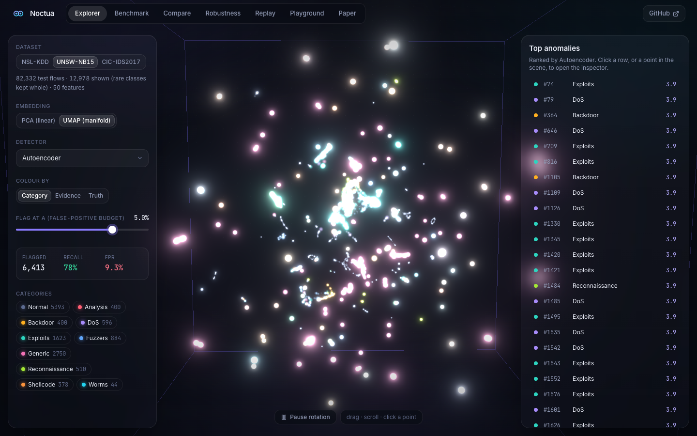
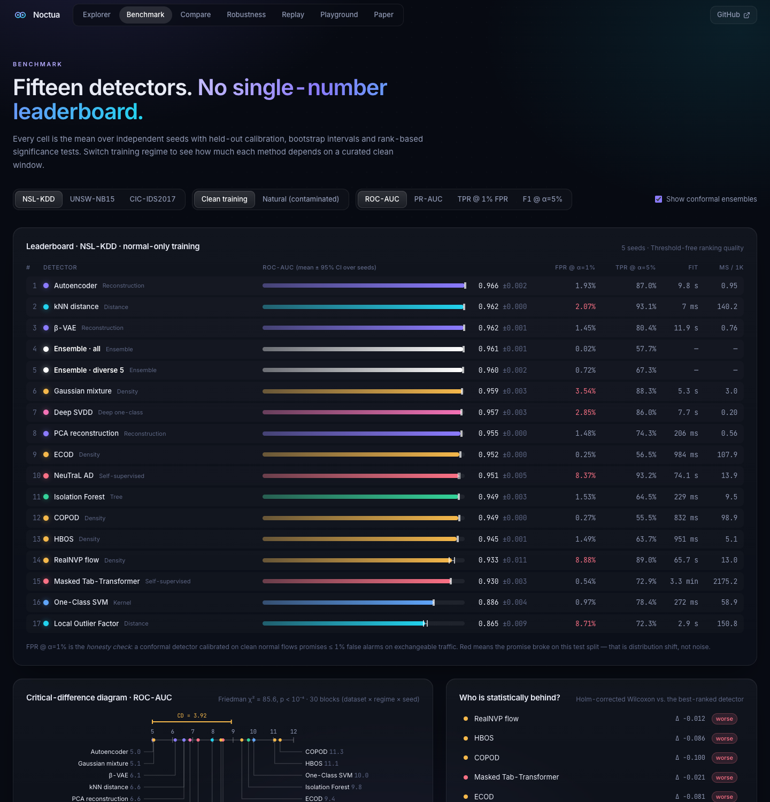
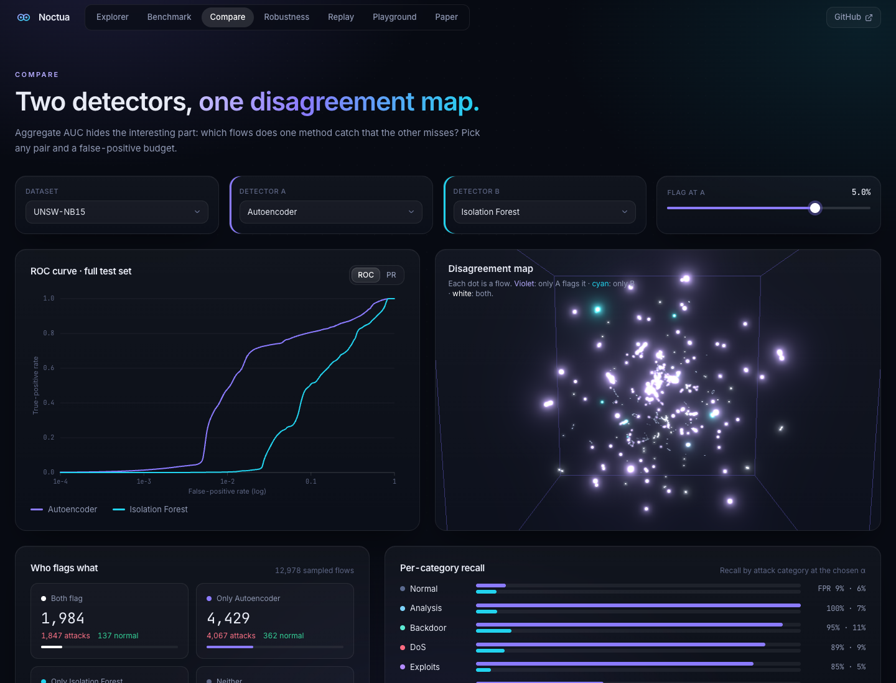
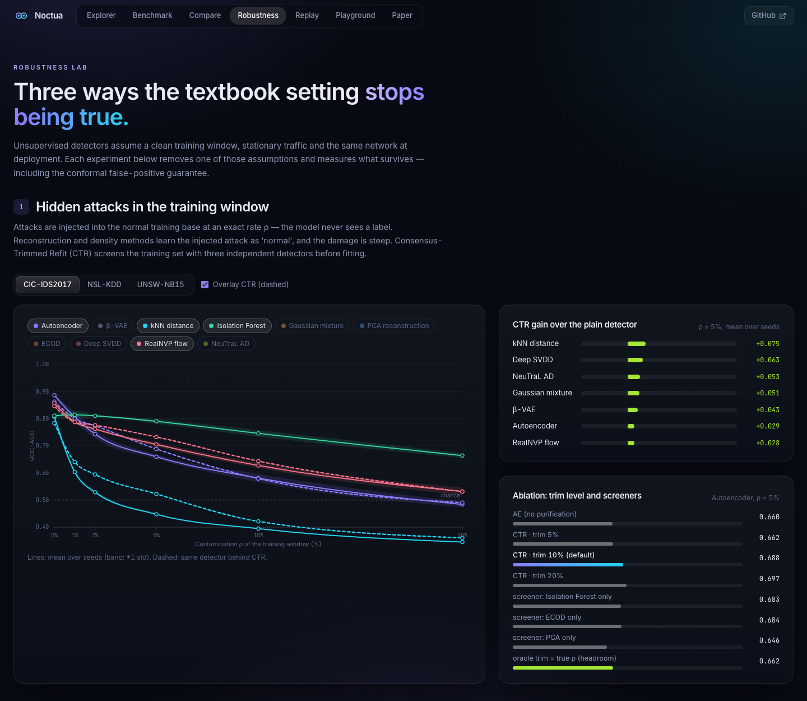
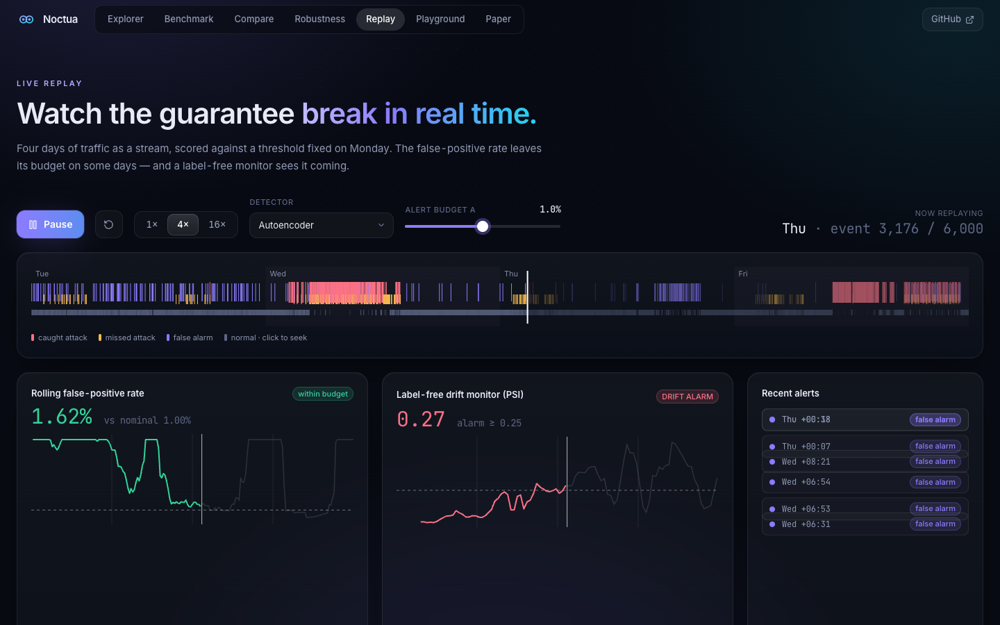
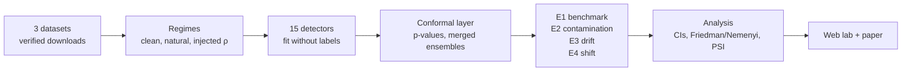

<div align="center">


# Noctua

**Unsupervised network intrusion detection, under pressure.**

A reproducible research protocol and an interactive 3D lab that stress-test 15 anomaly detectors
against hidden attacks in training, temporal drift and dataset shift, with conformal guarantees you can check.

[](https://github.com/fragompul/unsupervised-anomaly-network-intrusion/actions/workflows/ci.yml)
[](https://github.com/fragompul/unsupervised-anomaly-network-intrusion/actions/workflows/app.yml)


[](LICENSE)

[**Live app**](https://fragompul.github.io/unsupervised-anomaly-network-intrusion/) &nbsp;·&nbsp;
[**Paper (PDF)**](paper/main.pdf) &nbsp;·&nbsp;
[**Docs**](https://fragompul.github.io/unsupervised-anomaly-network-intrusion/docs/) &nbsp;·&nbsp;
[**Protocol**](docs/protocol.md) &nbsp;·&nbsp;
[**Cite**](#cite)

<br />

<a href="https://fragompul.github.io/unsupervised-anomaly-network-intrusion/">
  
</a>

<br />
<br />

<table>
  <tr>
    <td align="center"><b>15</b><br /><sub>detectors</sub></td>
    <td align="center"><b>3</b><br /><sub>datasets</sub></td>
    <td align="center"><b>4</b><br /><sub>experiments</sub></td>
    <td align="center"><b>228k</b><br /><sub>test flows</sub></td>
    <td align="center"><b>5</b><br /><sub>seeds</sub></td>
    <td align="center"><b>0</b><br /><sub>labels used to fit</sub></td>
  </tr>
</table>

</div>

## Why this exists

Unsupervised detectors are attractive for intrusion detection because labels are scarce and attacks
evolve. They are also almost always evaluated on a **clean training window**, **stationary traffic** and
**a single network**. Noctua removes those assumptions one at a time and measures what survives.
Every detector's score is turned into a false-positive guarantee with **split-conformal calibration**,
and that guarantee is then tested until it breaks.

The project started as an NSL-KDD benchmark and grew into a reproducible protocol, a
[paper](paper/main.pdf) and an [interactive lab](https://fragompul.github.io/unsupervised-anomaly-network-intrusion/).

## Key findings

All numbers are recomputed from raw scores (5 seeds). Full tables: [benchmark results](docs/benchmark_results.md).

| Question | Result |
|:--|:--|
| **What do hidden attacks cost?** | With only **5 % contamination** in the training window, detectors lose **11.4 ROC-AUC points on average** (up to **36** for kNN). Reconstruction, density and distance models learn the attack as normal. |
| **Can it be repaired without labels?** | **Consensus-Trimmed Refit (CTR)**, a screen by three independent detectors before fitting, recovers **+5.4 points at ρ = 5 %** and improves **21 of 21** dataset-detector pairs. It costs 2.5 points on clean data and fades at ρ ≥ 10 %. A single well-matched screener can match the committee; a poor one hurts. |
| **Does conformal calibration hold?** | At a nominal 1 % false-positive budget, single detectors realize **2.1 to 4.9 %** even in-dataset. A diverse 5-detector conformal merge stays within budget (**0.2 to 1.7 %**) at **41 to 67 %** recall. |
| **What happens under drift?** | A Monday-calibrated threshold realizes **1.6 %** FPR on Wednesday and **7.6 %** on Thursday. A label-free **PSI** of benign scores tracks the failure (Spearman ρ = 0.52) and flags broken guarantees with 75 % precision at 94 % recall. |
| **Does it transfer?** | UNSW-NB15 and CIC-IDS2017 on 18 aligned features: **0.695** AUC (U→C) and **0.446** (C→U, below chance), with realized FPR of **56 %** and **28 %** at a nominal 1 %. |
| **Which detector wins?** | The **autoencoder** has the best mean rank (5.0; Friedman χ² = 85.6, Nemenyi CD = 3.92), statistically tied with the next nine. NeuTraL AD is best on UNSW-NB15 (0.931). |
| **Can scores be explained?** | AE per-feature error is an exact decomposition of the score. Deleting the top 3 attributed features removes **51 / 15 / 38 %** of it (NSL / UNSW / CIC) versus 2 / 1 / 3 % for random features. |

## The lab

A static React 19 + WebGL application, deployed on GitHub Pages with no backend.
**[Open it](https://fragompul.github.io/unsupervised-anomaly-network-intrusion/)** and explore the results instead of reading tables.

<table>
  <tr>
    <td width="50%"><br /><b>3D Explorer.</b> 36k real flows in WebGL. Morph PCA into UMAP, flag by false-positive budget, and open any flow to see every detector's evidence and an exact feature attribution.</td>
    <td width="50%"><br /><b>Benchmark.</b> Leaderboard with bootstrap CIs, critical-difference diagram, per-category recall heatmap and a calibration-honesty column.</td>
  </tr>
  <tr>
    <td width="50%"><br /><b>Compare.</b> Any two detectors head to head: ROC and PR overlay, agreement table and a 3D disagreement map.</td>
    <td width="50%"><br /><b>Robustness lab.</b> Contamination and CTR, drift heatmap with PSI alarm, transfer matrix and conformal reliability diagrams.</td>
  </tr>
  <tr>
    <td width="50%"><br /><b>Live replay.</b> Four days of traffic as a stream: rolling FPR against budget, a label-free drift alarm and an alert feed.</td>
    <td width="50%" valign="top"><b>Playground.</b> Edit a flow's features and watch the verdict move. The autoencoder runs <b>entirely in your browser</b>, verified against PyTorch to 3 decimals.<br /><br /><b>Paper.</b> The manuscript and a method summary, one click away.</td>
  </tr>
</table>

```bash
cd app && npm install && npm run dev     # http://localhost:5173
```

## How it works



| | |
|:--|:--|
| **Datasets** | NSL-KDD (2009), UNSW-NB15 (2015) and CIC-IDS2017 with a temporal split (train Mon-Tue, test Wed-Fri). All three download without a registration form, pinned by SHA-256 ([details](docs/datasets.md)). |
| **Detectors** | Isolation Forest, One-Class SVM, PCA, GMM, kNN, LOF, ECOD, COPOD, HBOS, Autoencoder, Deep SVDD, β-VAE, RealNVP flow, NeuTraL AD and a masked tab-transformer. One interface, fixed configurations, no label-tuned hyper-parameters. |
| **Calibration** | A held-out clean slice gives conformal p-values with a finite-sample FPR bound. Averaged p-values merge detectors validly. |
| **Statistics** | Bootstrap CIs, Friedman + Nemenyi, Holm-corrected Wilcoxon. |
| **Explainability** | Exact autoencoder attributions with a deletion-faithfulness test. |

## Reproduce everything

```bash
python -m venv .venv && source .venv/bin/activate
pip install -e ".[dev,api,paper,notebooks]"

python -m ids_anomaly.cli data                                  # verified downloads (SHA-256)
python -m ids_anomaly.cli benchmark --experiment all --seeds 5 --workers 3
python -m ids_anomaly.cli analyze                               # tables, statistics, conformal coverage
python -m ids_anomaly.export                                    # artifacts for the web app
python paper/make_assets.py && (cd paper && tectonic main.tex)  # figures, macros, PDF
```

A full run takes about 3 hours on a 10-core laptop, CPU only. Experiment cells are **resumable** and
**fault-isolated**, and compute is decoupled from analysis: cells store raw scores and every reported
number is recomputed from them. With Docker, `docker compose up` serves the app and the API on `localhost:8000`.

## Repository map

```
src/ids_anomaly/
  data/         verified downloads, loaders, harmonized UNSW/CIC view
  detectors/    15 detectors + Consensus-Trimmed Refit
  protocol/     regimes, E1-E4 cells, conformal, metrics, statistics, analysis
  explain/      exact attributions + deletion-faithfulness test
  export/       quantized artifacts for the web app
  api/          optional FastAPI service (same scoring as the browser)
app/            React 19 + TypeScript + WebGL lab (Vite, Tailwind 4, Playwright)
paper/          LaTeX manuscript; every number and figure generated from results
docs/           protocol, datasets, benchmark results, limitations (MkDocs Material)
tests/          network-free pytest suite
dashboard/      legacy Bokeh dashboard from v0.1 (NSL-KDD)
```

## Engineering

* **Quality gates:** ruff, mypy and pytest on Python 3.10 and 3.12; type-check, vitest and Playwright for the app; MkDocs in strict mode. All of it runs in [GitHub Actions](.github/workflows).
* **Honest limitations** ([docs/limitations.md](docs/limitations.md)): lab-generated datasets with documented issues, fixed hyper-parameters, seeds are not dataset replicates, a clean calibration slice is assumed, CTR needs a contamination bound and there are no adaptive adversaries.
* **Data quirks handled:** the UNSW-NB15 mirror swaps its `train` and `test` names; CIC-IDS2017 timestamps mix two formats on a 12-hour clock without AM/PM; pandas 3 string columns must never be pickled into score files.

## Cite

```bibtex
@misc{gomezpulido2026noctua,
  title  = {Noctua: Unsupervised Network Intrusion Detection under Training Contamination, Temporal Drift and Dataset Shift},
  author = {Gómez Pulido, Francisco Javier},
  year   = {2026},
  url    = {https://github.com/fragompul/unsupervised-anomaly-network-intrusion}
}
```

## Author

**Francisco Javier Gómez Pulido**, AI Lead at Aapex. AI Lead and MLOps architect focused on scalable
architectures, data science pipelines and production-grade AI with real business impact. Double degree in
Mathematics and Computer Science; Master's in Artificial Intelligence.

[LinkedIn](https://www.linkedin.com/in/frangomezpulido) &nbsp;·&nbsp; [GitHub](https://github.com/fragompul) &nbsp;·&nbsp; [Email](mailto:frangomezpulido2002@gmail.com)

Released under the [MIT License](LICENSE).
