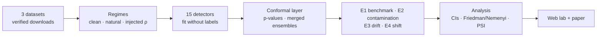

<div align="center">

# 🦉 Noctua

### Unsupervised network intrusion detection, under pressure.

**15 detectors · 3 datasets · conformal guarantees · contamination, drift and shift — explored in a WebGL research lab.**

[](https://github.com/fragompul/unsupervised-anomaly-network-intrusion/actions/workflows/ci.yml)
[](https://github.com/fragompul/unsupervised-anomaly-network-intrusion/actions/workflows/app.yml)


**[Live app](https://fragompul.github.io/unsupervised-anomaly-network-intrusion/)** · **[Paper (PDF)](paper/main.pdf)** · **[Docs](https://fragompul.github.io/unsupervised-anomaly-network-intrusion/docs/)** · **[Protocol](docs/protocol.md)**


</div>

---

## Why this exists

Unsupervised detectors are attractive for intrusion detection — labels are scarce and attacks evolve —
but they are almost always evaluated on a **clean training window**, **stationary traffic** and **one
network**. Noctua removes those assumptions one at a time and measures what survives, with
**split-conformal calibration** turning every detector's score into a false-positive guarantee that
is then tested until it breaks.

It started as an NSL-KDD benchmark and grew into a reproducible research protocol, a paper
([`paper/`](paper/)) and an interactive lab ([`app/`](app/)).

## What the experiments found

All numbers are recomputed from raw scores (5 seeds; see [benchmark results](docs/benchmark_results.md)).

| | Finding |
|---|---|
| **Hidden attacks poison the baseline** | At just **5 % contamination** the training window costs **11.4 ROC-AUC points on average** (up to **36** for kNN). Reconstruction, density and distance models learn the attack as normal. |
| **Consensus-Trimmed Refit (ours)** | A label-free screen by three independent detectors (Isolation Forest, ECOD, PCA) before fitting recovers **+5.4 points at ρ = 5 %**, improving **21 / 21** dataset–detector pairs; it costs **−2.5 points on clean data**, and its benefit fades at ρ ≥ 10 %. A single well-matched screener (ECOD) can match the committee; a poor one (PCA) hurts — the committee buys robustness, not dominance. |
| **Calibration is only as good as exchangeability** | At a nominal 1 % false-positive budget, single detectors realize **2.1–4.9 %** even in-dataset. A *diverse* 5-detector conformal merge stays within budget (**0.2–1.7 %**) at **41–67 %** recall (α = 5 %); merging all 15, weak members included, is valid but nearly powerless on UNSW-NB15 (1.4 % recall). |
| **Drift is not a smooth decay** | On CIC-IDS2017 a Monday-calibrated threshold realizes **1.6 %** FPR on Wednesday and **7.6 %** on Thursday (averaged over detectors); ECOD/COPOD/HBOS/Isolation Forest stay closest to budget, deep and density models break hardest. A **label-free PSI** of benign scores tracks it (Spearman ρ = 0.52); PSI ≥ 0.05 flags broken-guarantee cases with 75 % precision at 94 % recall. |
| **Transfer is poor** | UNSW-NB15 ↔ CIC-IDS2017 on 18 aligned features: **0.695** (U→C) and **0.446** (C→U, below chance) AUC vs. 0.667 / 0.757 in-dataset, with realized FPR of **56 %** and **28 %** at a nominal 1 %. Per-domain standardization helps one direction and hurts the other. |
| **Best single detector** | Autoencoder (mean rank 5.0, Friedman χ² = 85.6, Nemenyi CD = 3.92) — statistically tied with the nine next-ranked detectors (GMM, β-VAE, kNN, PCA, Deep SVDD, NeuTraL, LOF, flow, MTT). NeuTraL AD is best on UNSW-NB15 (0.931). The "natural" UNSW-NB15 split (68 % attacks) inverts most detectors (AUC < 0.5). |
| **Explanations are faithful** | AE per-feature error is an exact decomposition of the score; deleting the top-3 attributed features removes **51 / 15 / 38 %** of it (NSL / UNSW / CIC) vs. 2 / 1 / 3 % for random features. |

## The lab (web app)

A static React 19 + WebGL app (deployable on GitHub Pages, no backend). Eight pages:

| | |
|---|---|
|  | **3D Explorer.** 36k real flows in WebGL: morph PCA → UMAP, flag by false-positive budget, open any flow to see all 17 detectors' evidence and an exact feature attribution. |
|  | **Benchmark.** Leaderboard with bootstrap CIs, critical-difference diagram, per-category recall heatmap, accuracy-vs-cost scatter, calibration-honesty column. |
|  | **Compare.** Any two detectors: ROC/PR overlay, agreement table and a 3D *disagreement map*. |
|  | **Robustness lab.** Contamination + CTR, drift heatmap and PSI alarm, transfer matrix, conformal reliability diagrams. |
|  | **Live replay.** Four days of traffic as a stream: rolling FPR vs budget, a label-free drift alarm, alert feed. |
| | **Playground.** Edit a flow's features and watch the verdict move — the autoencoder runs **in your browser**, verified against PyTorch to 3 decimals. |

```bash
cd app && npm install && npm run dev     # http://localhost:5173
```

## Quickstart (reproduce everything)

```bash
python -m venv .venv && source .venv/bin/activate
pip install -e ".[dev,api,paper,notebooks]"

python -m ids_anomaly.cli data                                # verified downloads (SHA-256), no registration
python -m ids_anomaly.cli benchmark --experiment all --seeds 5 --workers 3
python -m ids_anomaly.cli analyze                             # tables, statistics, conformal coverage
python -m ids_anomaly.export                                  # artifacts for the web app
python paper/make_assets.py && (cd paper && tectonic main.tex)   # figures, macros, PDF
```

The full run takes about 3 h on a 10-core laptop (CPU only). Experiment cells are **resumable** and
**fault-isolated**; compute and analysis are decoupled (cells store raw scores; every reported number
is recomputed from them).

Docker: `docker compose up` serves the app and the API on `localhost:8000`.

## The protocol in one screen



* **Datasets:** NSL-KDD (2009), UNSW-NB15 (2015), CIC-IDS2017 (temporal split: train Mon–Tue, test Wed–Fri).
  All three are obtainable without a registration form ([details](docs/datasets.md)).
* **Detectors:** Isolation Forest, One-Class SVM, PCA, GMM, kNN, LOF, ECOD, COPOD, HBOS, Autoencoder,
  Deep SVDD, β-VAE, RealNVP flow, NeuTraL AD, masked tab-transformer — one interface, fixed configs (no label-tuned hyper-parameters).
* **Calibration:** a held-out clean slice gives conformal p-values with a finite-sample FPR bound; averaged p-values merge detectors validly.
* **Statistics:** bootstrap CIs, Friedman + Nemenyi, Holm-corrected Wilcoxon.

## Repository map

```
src/ids_anomaly/
  data/         verified downloads, loaders, harmonized UNSW↔CIC view
  detectors/    15 detectors + Consensus-Trimmed Refit
  protocol/     regimes, E1–E4 cells, conformal, metrics, statistics, analysis
  explain/      exact attributions + deletion-faithfulness test
  export/       quantized artifacts for the web app
  api/          optional FastAPI service (same scoring as the browser)
app/            React 19 + TypeScript + WebGL lab (Vite, Tailwind 4, Playwright)
paper/          LaTeX manuscript; every number/figure generated from results
docs/           protocol, datasets, benchmark results, limitations (MkDocs Material)
tests/          pytest (network-free): 129 tests · app/: vitest + Playwright e2e
dashboard/      legacy Bokeh dashboard from v0.1 (NSL-KDD)
```

## Engineering notes

* **Quality gates:** ruff, mypy, pytest on Python 3.10 and 3.12; type-check + vitest + Playwright for the app; MkDocs `--strict`.
* **Honest limitations** ([docs/limitations.md](docs/limitations.md)): lab-generated datasets with documented issues, fixed hyper-parameters,
  seeds ≠ dataset replicates, a clean calibration slice is assumed, CTR needs a contamination bound, no adaptive adversaries.
  TabPFN-style foundation models were evaluated for feasibility and excluded (per-feature conditional prediction is impractical on CPU).
* **Data quirks handled:** the UNSW-NB15 mirror swaps its `train`/`test` names; CIC-IDS2017 timestamps mix two formats on a 12-hour clock
  without AM/PM; pandas 3 string columns must never be pickled into score files.

## Cite

```bibtex
@misc{gomezpulido2026noctua,
  title  = {Noctua: Unsupervised Network Intrusion Detection under Training Contamination, Temporal Drift and Dataset Shift},
  author = {Gómez Pulido, Francisco Javier},
  year   = {2026},
  url    = {https://github.com/fragompul/unsupervised-anomaly-network-intrusion}
}
```

## 👤 Author

**Francisco Javier Gómez Pulido** — AI Lead at Aapex. AI Lead & MLOps Architect specialized in building scalable architectures,
data science pipelines, and generating real business impact through production-grade artificial intelligence. Double Degree in
Mathematics and Computer Science; Master's in Artificial Intelligence.

📫 [LinkedIn](https://www.linkedin.com/in/frangomezpulido) · [GitHub](https://github.com/fragompul) · [Email](mailto:frangomezpulido2002@gmail.com)

MIT License — see [LICENSE](LICENSE).
